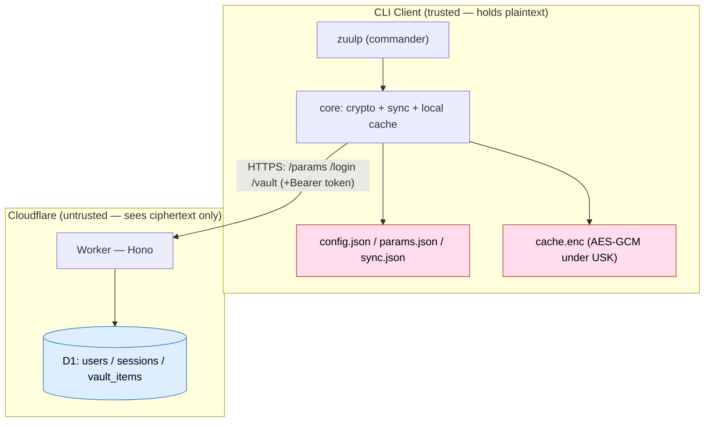
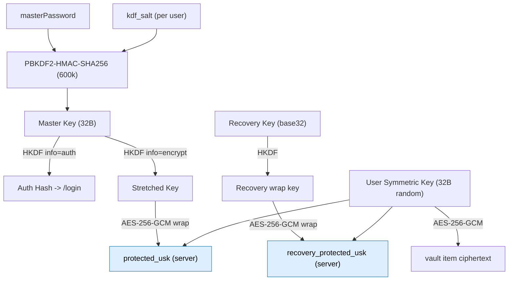
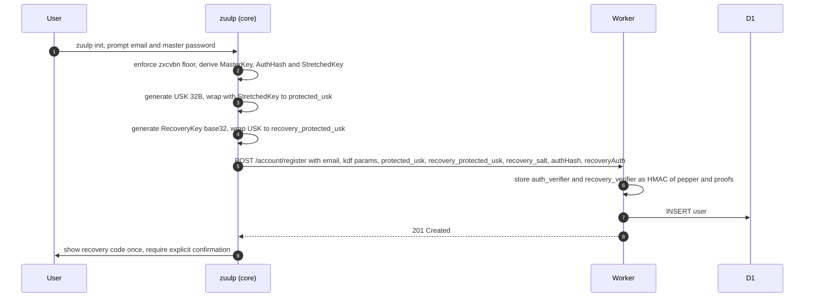
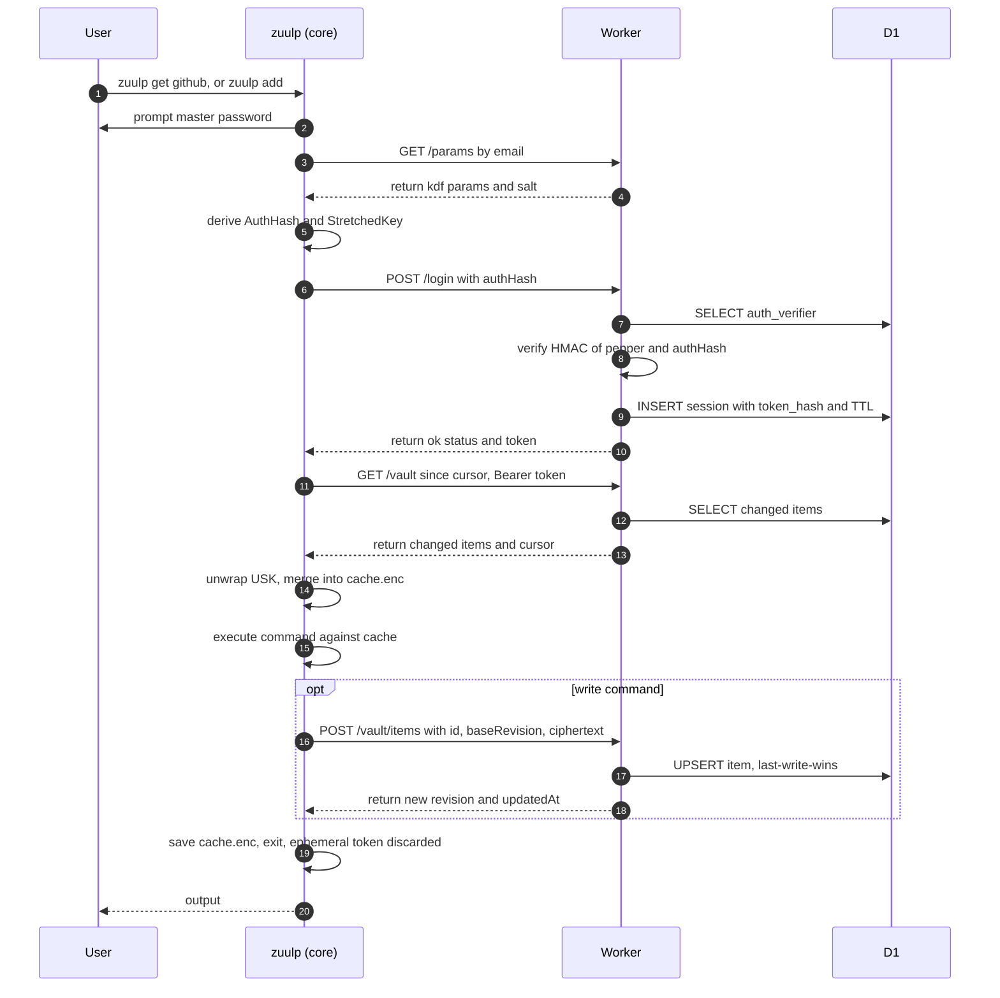
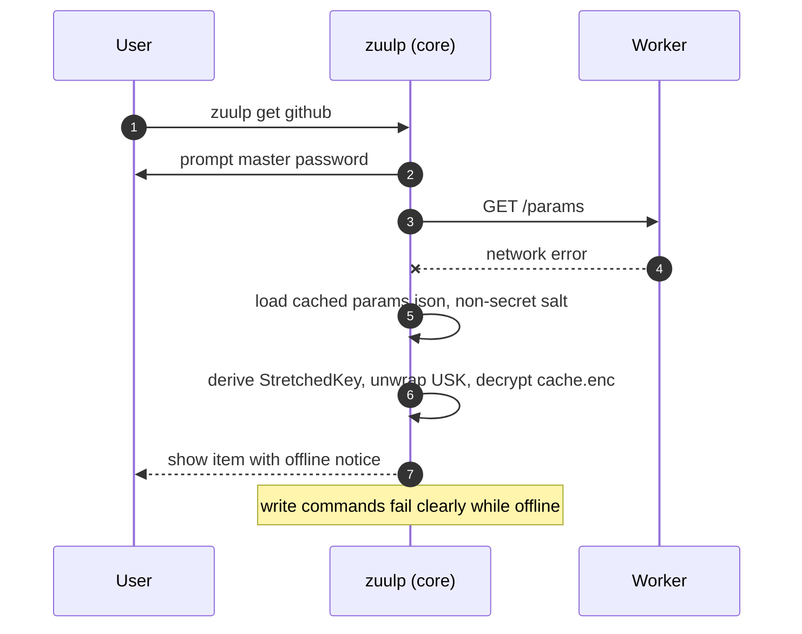
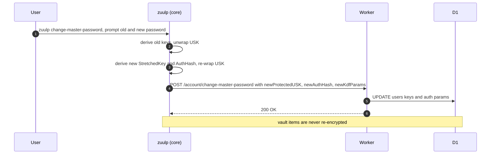
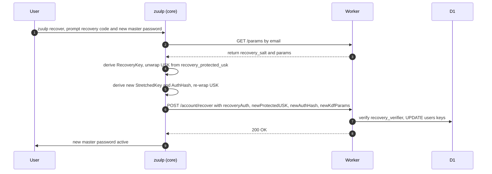
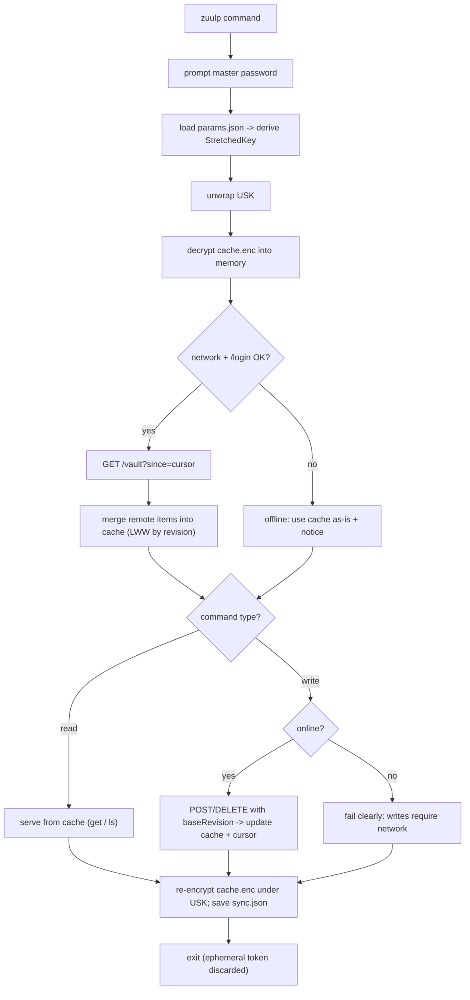
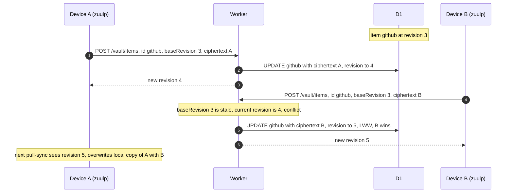
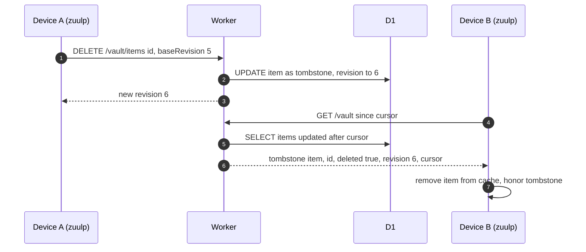

# ZuulPass — MVP Design

A zero-knowledge password manager: a Cloudflare Worker (free plan) stores only
ciphertext; a Node CLI (`zuulp`) performs all cryptography locally. Future rich
clients (TUI/web/mobile) and a session-capable backend are explicitly designed for.

## 1. Goals & scope

**In MVP:** accounts + recovery, vault CRUD, incremental sync, offline reads,
password generation, master-password change/recovery.

**Deferred:** TUI, web/mobile, sharing, 2FA, TOTP codes, auto-type, device
management, attachments, export/import, Argon2id, per-item data keys.

## 2. Threat model & principles

- **Zero-knowledge:** the server never sees the master password, any key, or plaintext.
- **Accepted risk:** losing *both* the master password and recovery code = permanent loss.
- **Adversaries defended:** honest-but-curious server, breached DB, compromised CF account.
- **Envelope versioning** everywhere for forward-compatible algorithm migration.
- Pass-the-hash defeated by server-side HMAC-with-pepper on the auth verifier.

## 3. Cryptography & key hierarchy

```
masterPassword + per-user kdf_salt
   └─ PBKDF2-HMAC-SHA256 (600,000 iters)  ─▶  Master Key (32B)
         ├─ HKDF(info="auth")     ─▶  Auth Hash        (sent to /login)
         └─ HKDF(info="encrypt")  ─▶  Stretched Key    (never leaves device)

User Symmetric Key  USK = 32 random bytes (generated at signup)
   ├─ AES-256-GCM(Stretched Key) ─▶ protected_usk            [server]
   └─ AES-256-GCM(Recovery Key)  ─▶ recovery_protected_usk   [server]

Recovery Key = 256-bit random (base32, shown once)
   └─ HKDF(salt=recovery_salt, info="recovery")      ─▶ Recovery wrap key
        └─ HKDF(info="recovery-auth")                ─▶ Recovery Auth Proof

vault item payload:  USK ─ AES-256-GCM ─▶ ciphertext
```

- **Cipher:** AES-256-GCM (WebCrypto). **Envelope:** `{ v, alg, nonce(12B), ct }`.
- **KDF params are versioned per user** (`kdf`, `kdf_salt`, `kdf_params`, `kdf_version`).
  Argon2id is a drop-in later; migration re-wraps the USK only (items are never re-encrypted).
- **Master-password floor:** zxcvbn score >= 3.

## 4. Auth & sessions

- **Opaque session tokens**, stored as `SHA-256(token)` in D1.
- **Sliding expiry + absolute cap**; optional **`ephemeral` TTL hint** (used by the CLI).
- Login response is a **state machine** (`{ status }`) so 2FA can be added later.
- `label` / `last_seen_at` columns reserved now for future device management.
- **Decoy salt** returned for unknown emails on `/params`.
- Server auth verifier: `HMAC-SHA256(serverPepper, authHash)`.

## 5. Storage — single D1 database

```
users(
  id, email UNIQUE, created_at,
  kdf, kdf_salt, kdf_params, kdf_version,
  protected_usk, recovery_protected_usk, recovery_salt,
  auth_verifier, recovery_verifier
)
sessions(
  id, user_id, token_hash, kind, label NULL,
  created_at, last_seen_at, expires_at, absolute_expires_at
)
vault_items(
  id, user_id, revision, updated_at, deleted,   -- plaintext sync metadata
  ciphertext                                     -- encrypted payload ONLY
)
-- indexes: users(email), sessions(token_hash), vault_items(user_id, updated_at)
```

**Encrypted payload (decrypted view):**

```json
{
  "type": "login|note",
  "name": "",
  "username": "",
  "password": "",
  "urls": [{ "url": "", "match": "host" }],
  "totp": null,
  "notes": "",
  "fields": [{ "name": "", "value": "", "hidden": false }],
  "folder": "",
  "favorite": false
}
```

Free-plan guardrails: index every filtered column (5M rows-read/day cap);
respect 100k rows-written/day and 50 queries per invocation.

## 6. API surface

```
GET    /params?email=          -> { kdf, salt, params, version }        (pre-auth, decoy-safe)
POST   /login   { authHash }   -> { status:"ok", token, expiresAt }
POST   /refresh                -> { expiresAt }
POST   /logout                 -> 204
POST   /account/register       -> 201
POST   /account/change-master-password { newProtectedUSK, newAuthHash, newKdfParams }
POST   /account/recover        { recoveryAuth, newProtectedUSK, newAuthHash, newKdfParams }
GET    /vault?since=<ts>       -> { items:[...], cursor }
POST   /vault/items            { id, baseRevision, ciphertext }         (LWW)
DELETE /vault/items/:id        { baseRevision }                         (tombstone)
```

Implemented with **Hono**, **Zod** schemas in `api-types`, and **`hono/client`**
for an end-to-end typed client.

## 7. Sync model

- **Per-item rows**; incremental pull via `GET /vault?since=`; server-clock
  `updated_at`, `revision`, and tombstones for deletes.
- **Last-write-wins per item** (no merge UI).
- **Offline model B:** reads serve from the local encrypted cache; writes
  require a successful server round-trip.

## 8. Client state (CLI)

| File | Contents | Sensitivity |
|---|---|---|
| `config.json` | `{ serverUrl, email }` | low |
| `params.json` | cached KDF params + salt (enables offline unlock) | **non-secret** |
| `cache.enc` | vault items, AES-GCM under USK | ciphertext |
| `sync.json` | last-sync cursor | low |

Default location `ZUULPASS_HOME` (default `%APPDATA%\zuulpass` on Windows).

## 9. CLI (MVP client)

```
zuulp init      zuulp add      zuulp edit <name|id>   zuulp rm <name|id>
zuulp get <name> [--field ...] [--json] [--copy]
zuulp ls [--folder X] [--query q] [--json]
zuulp gen [--length N | --passphrase] [--copy]    # no auth, no network
zuulp change-master-password    zuulp recover
```

- **No `login`/`logout`/`sync` commands.** Every authenticated command runs a
  hidden preamble: prompt master password -> `GET /params` -> derive keys ->
  `POST /login` (ephemeral token) -> pull-sync -> run command -> save cache -> exit.
- `--password-stdin` for scripts; never a plaintext `--password` flag.
- **Name resolution is client-side** (names are encrypted); ambiguous matches prompt to choose.
- `zuulp get` prints the password; `--copy` uses the clipboard with auto-clear (~30s, configurable).
- `zuulp init`: email + master password (zxcvbn >= 3) -> USK -> print recovery code once
  -> require explicit "I saved it".
- Libraries: `commander`, `@inquirer/prompts`, `clipboardy`, `@zxcvbn-ts/core`,
  `cli-table3`, `picocolors`, `@scure/base`; crypto via **WebCrypto only**.

## 10. Monorepo & tooling

```
zuulpass/
  packages/
    core/       # crypto, key hierarchy, sync engine, vault ops, config, local cache (no UI)
    api-types/  # Zod schemas + inferred types (single source of truth)
    worker/     # Hono on Cloudflare Workers
    cli/        # thin Node CLI over core + api-types
```

- **pnpm workspaces** (Turborepo deferred); strict TS with project references.
- **Wrangler** (dev, D1 migrations, `secret put` pepper); **Vitest** everywhere;
  Worker tests via **`@cloudflare/vitest-pool-workers`**; **GitHub Actions** CI.

## 11. MVP build order

1. Scaffold monorepo (pnpm, tsconfig base, vitest).
2. `api-types`: Zod schemas for every endpoint + payloads.
3. `core` crypto: PBKDF2/HKDF/AES-GCM envelope, key hierarchy, recovery — with test vectors.
4. `core`: config, local encrypted cache, sync engine, `VaultService` (headless).
5. `worker`: Hono routes, D1 schema + migrations, auth/sessions, vault CRUD, incremental sync.
6. `cli`: skeleton, `init`, unlock/sync preamble, `get`/`ls`, `add`/`edit`/`rm`, `gen`,
   `change-master-password`, `recover`.
7. Integration tests (CLI <-> local Worker) + CI.

## 12. Key risks

- **10 ms Worker CPU** — keep server work I/O-bound (HMAC pepper, no heavy hashing).
- **Crypto correctness** — treat `core/crypto` as the highest-risk module; test-vector it hard.
- **PBKDF2 downgrade** — mitigated by the strong-password floor; keep the Argon2id path intact.
- **Free-plan enforcement** — index everything; keep queries per invocation low.

## 13. Architecture diagram



## 14. Key hierarchy



## 15. Call sequences

### 15.1 Account creation (`zuulp init`)



### 15.2 Authenticated command (`zuulp get` / `zuulp add` / ...)



### 15.3 Offline read (graceful degradation)



### 15.4 Change master password (no item re-encryption)



### 15.5 Recovery (`zuulp recover`)



## 16. Local caching & sync approach

The local cache is a **single USK-encrypted file** (`cache.enc`) that mirrors the
server's item set, plus a **cursor** (`sync.json`). Every authenticated command
runs **pull-sync before executing**, so the cache is fresh when the command runs;
writes update both server and cache. Reads fall back to the cache when offline.



**Properties:**

- **Read-through:** the cache is updated on every pull, so `get`/`ls` reflect the
  latest server state while still working offline.
- **Write-through:** writes only commit to the cache after the server confirms,
  keeping cache and server consistent (no pending-write queue in MVP).
- **Encrypted at rest:** `cache.enc` is AES-GCM under the USK; `params.json` and
  `sync.json` hold only non-secret material.
- **TTL-free:** because the master password is re-entered each command, the USK
  never persists; the on-disk cache is useless without the master password.

## 17. Conflict resolution — last-write-wins (LWW)

Each item carries a monotonically increasing server-side `revision` and a
server-clock `updated_at`. A write sends the `baseRevision` the client last saw;
the server accepts and increments `revision`. Deletes are tombstones. Because the
CLI pull-syncs before every command, conflicting bases are rare; when they occur,
the later write simply wins (no merge UI in MVP).



**Deletes** use the same mechanism via a tombstone so a `deleted=1` row with a
higher `revision` propagates to every device on its next pull.


